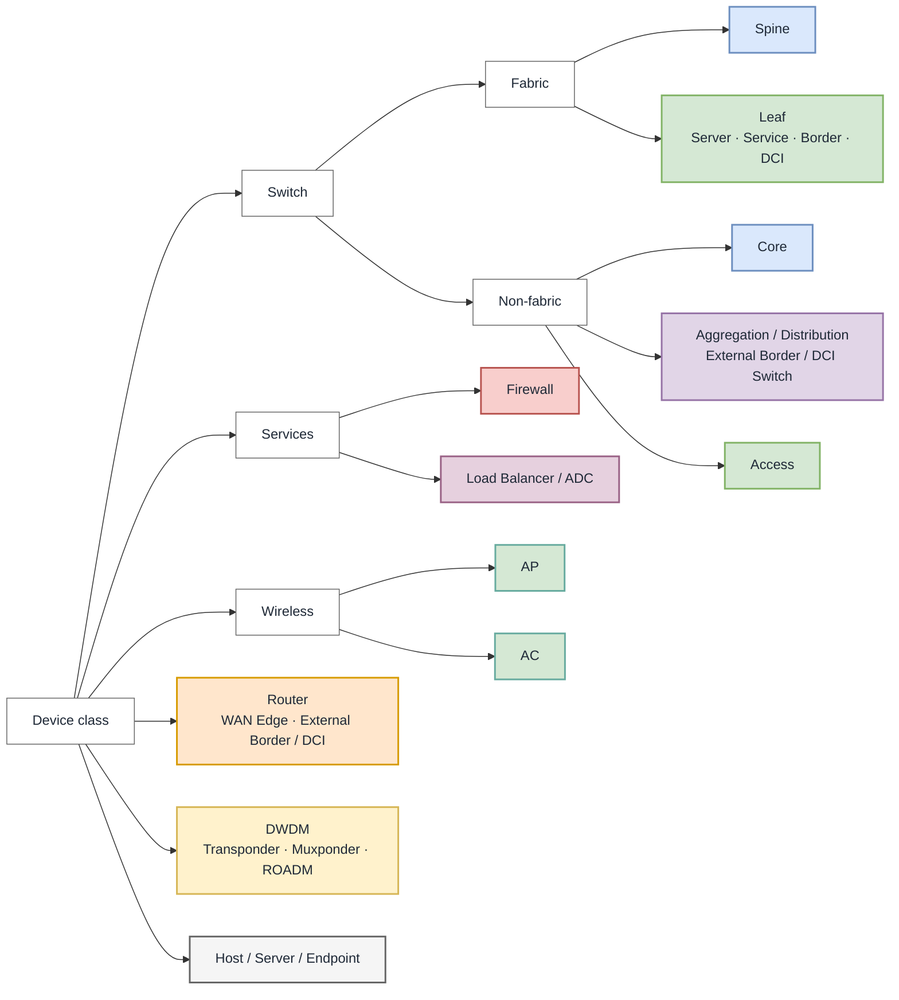

# Network Topology Figures

Plugin-agnostic content and visual conventions for network topology figures.
Every maintained figure needs an editable canonical source; its implementation
adapter defines the format, validation, export, and publication workflow.

## Purpose, scope, and viewpoint

State the figure's purpose, abstraction level, and one primary viewpoint:

| Viewpoint | Shows |
|---|---|
| Physical | Devices, ports, cables, bundles, sites, and failure domains |
| Logical or control plane | Adjacencies, overlays, tunnels, VRFs, and logical boundaries |
| Service or traffic flow | Service traversal, direction, policy, and ingress/egress paths |
| POC or test | Tested topology, exercised links, failure actions, and relevant configuration context |

Use `atomic schematic`, `reference architecture`, or `implementation-specific`
as the abstraction level. A hybrid viewpoint must distinguish its layers with
boundaries or a legend. The caption may carry this context to avoid figure clutter.

## Figure anatomy

Every figure needs:

1. A short title.
2. A label on every device or functional node.
3. Boundaries for sites, fabrics, pods, zones, or failure domains when relevant.
4. A legend when color, line style, or shape is not self-explanatory.
5. A numbered caption in the consuming document stating the figure's purpose.

Use layer labels such as `SPINE`, `LEAF`, `WAN`, or `SECURITY SERVICES` when
placement encodes architecture. Omit decoration that adds no topology, role, or
traffic-flow meaning.

## Canonical visual encoding

Represent a network device with a labeled rectangular **device card**. It is
compact, vendor-neutral, and can hold relevant interfaces, VRFs, or routing
domains. Always write the device role; shape and color are secondary cues.

```text
┌────────────────────────┐
│ Spine 1                │  Role or logical name
│ DC1-SP01               │  Hostname, when relevant
│ ASN 65001 · VRF PROD   │  Relevant context, when needed
└────────────────────────┘
```

Card detail is **minimal** (role), **identified** (role plus hostname), or
**detailed** (only the interfaces, VRFs, ASNs, addresses, or platform facts the
figure needs). Put interface names beside their link endpoints and use card
compartments for multiple VRFs or interface groups; never paste configuration.

Classify a node as `device class → fabric membership (switches only) →
architectural role → functional qualifier`.

| Device class | Domain | Architectural role | Functional qualifier / label | Preferred representation | Fill / stroke |
|---|---|---|---|---|---|
| Switch | Fabric | Spine | `Spine 1` | Rectangular device card | Blue `#DAE8FC` / `#6C8EBF` |
| Switch | Fabric | Leaf | `Server Leaf 1`, `Service Leaf 1`, `Border Leaf 1`, `DCI Leaf 1` | Rectangular device card | Green `#D5E8D4` / `#82B366` |
| Switch | Non-fabric | Core | `Core 1`, `Collapsed Core 1` | Rectangular device card | Blue `#DAE8FC` / `#6C8EBF` |
| Switch | Non-fabric | Aggregation or distribution | `Aggregation 1`, `Distribution 1`, `External Border Switch 1`, `External DCI GW 1` | Rectangular device card | Purple `#E1D5E7` / `#9673A6` |
| Switch | Non-fabric | Access | `Access 1` | Rectangular device card | Green `#D5E8D4` / `#82B366` |
| Router | External routed domain | Router | `Router 1`, `WAN Edge 1`, `External Border Router 1`, `External DCI GW 1` | Rectangular device card | Orange `#FFE6CC` / `#D79B00` |
| DWDM | Optical transport | Optical system | `DWDM 1`, `Transponder 1`, `Muxponder 1`, `ROADM 1` | Rectangular device card | Yellow `#FFF2CC` / `#D6B656` |
| Firewall | Security or service layer | Firewall | `Firewall 1`, `Virtual FW 1` | Rectangular device card | Red `#F8CECC` / `#B85450` |
| Load balancer | Service layer | Load balancer or ADC | `LB 1`, `Virtual LB 1`, `GSLB 1` | Rectangular device card | Pink `#E6D0DE` / `#996185` |
| AP | Wireless access | Access point | `AP 1` | Compact rectangular device card | Turquoise `#D5E8D4` / `#67AB9F` |
| AC | Wireless control | Access controller | `AC 1`, `Virtual AC 1` | Rectangular device card | Turquoise `#D5E8D4` / `#67AB9F` |
| Host, server, or endpoint | Attached workload | Endpoint | Hostname or workload role | Rounded endpoint card | Gray `#F5F5F5` / `#666666` |
| Network or provider domain | Abstract external domain | WAN, Internet, or provider network | Provider or service name | Cloud or bounded domain | Gray `#F5F5F5` / `#666666` |

This Mermaid preview makes the taxonomy and palette visible in Markdown. It is
not the canonical source format for maintained figures.



Classification notes:

- Color reinforces labels and may be overridden only with a legend. Preserve
  readable text and borders in light and dark themes.
- Blue represents the upper tier (spine/core), purple the intermediate tier
  (aggregation/distribution), and green the attachment tier (leaf/access).
- A leaf qualifier identifies function: `Server`, `Service`, `Border`, or `DCI`.
  A controller-managed DCI leaf stays green.
- Outside the fabric, classify a border or DCI gateway by device: purple for an
  aggregation switch, orange for a router. Never label either as a `DCI Leaf`.
- DWDM is yellow optical transport. Keep it separate from the connected packet
  switch or router.
- Firewalls, load balancers, APs, and ACs retain their classes regardless of
  attachment or physical/virtual deployment.
- A cloud represents an abstract domain, not a router. Put vendor/platform
  identity in text; vendor icons may decorate but never replace the role label.
- **A border leaf is still a leaf.** Keep its leaf fill and leaf size preset; draw it
  in a row of its own above the spine pair only when the figure has to show the
  north-south boundary explicitly, and place it next to the firewall or external router
  it faces.
- **"IPN" is an ACI term; the inter-site pair's card depends on which platform is drawn.**
  In Cisco ACI the IPN is a separate routed underlay that belongs to no single fabric —
  draw it as an **aggregation-tier card: purple fill, medium preset (68 × 32), placed
  outside the fabric's boundary container**, never as a leaf, and keep the label `IPN`
  (see [skills/vendor-matrix/cisco/aci.md](../skills/vendor-matrix/cisco/aci.md)). Huawei
  CloudFabric has no IPN: the same function is a **DCI leaf** that belongs to one specific
  fabric — draw it as a leaf (**green fill, small preset 45 × 32**) inside that fabric's
  container and label it `DCI leaf`; the solution documentation also calls the node a DCI
  gateway or fabric gateway, and each one sits in exactly one fabric (see
  [skills/vendor-matrix/huawei/cloudfabric.md](../skills/vendor-matrix/huawei/cloudfabric.md#dci-gateway-role)).
  Either way, place the pair facing the other site: two cards **vertically aligned on one
  axis** at the fabric edge that faces the remote data center, with the inter-site
  transport (DWDM) centred on the pair's horizontal midline. It must not sit beside the
  spine row, where it reads as another fabric switch.

### Card sizes and spacing

Card size is a house convention, not a draw.io requirement. Two presets cover the
figures in this library; sizes are in draw.io units.

| Preset | W × H | Label | Applies to |
|---|---|---|---|
| Small | 45 × 32 | 10 pt | Leaf switches (server, service, border, DCI), WAN and edge routers, hosts (storage arrays, bare-metal servers, hypervisor hosts) |
| Medium | 68 × 32 | 11 pt | Spine switches, aggregation and distribution switches, firewalls, DWDM and other optical systems, core routers, load balancers |
| Boundary | Container | 14 pt bold, label in the top-left corner | One solid boundary per site, one dashed boundary per fabric or region nested inside it |

Two router roles sit on either side of the line: a WAN or edge router normally carries a
single ISP uplink and takes the small card, while a core router fans out to many links and
takes the medium one.

- **One preset per role.** Never mix presets within a row, except where a lone role
  needs the wider card to hold its label.
- **Spacing:** 6 units between the two switches of a pair, 14 units between pairs, and
  at least 16 units between a container and the cards inside it.
- **A card alone under a switch pair is centred on the pair's midline**, not under one
  of the two switches — a load balancer under a leaf pair, for example.
- **Container children set coordinates relative to the container**, and an edge's parent
  is the innermost container that holds both of its ends, otherwise the layer — see
  [plugins/drawio-mcp.md](../plugins/drawio-mcp.md) §2.
- **Link to the facing edge, not the centre line.** Leave the upper card's bottom-centre
  (`exitX=0.5;exitY=1`) and land on the lower card's top-centre
  (`entryX=0.5;entryY=0`); for side-by-side cards use right-centre to left-centre the
  same way. Without an anchor the renderer aims at the target's centre, so a link into
  a row of cards has already dipped into the row's band before it arrives and crosses
  the top corners of the cards in between — the reason a spine-leaf fan can look like it
  attaches to the wrong leaf. This is the standard construction for spine-leaf figures:
  rows of pairs, links drawn between the facing edges.

Change a preset only when a role's label no longer fits, and then change it for that
role everywhere.

## Link and traffic semantics

| Style | Meaning |
|---|---|
| Solid, no arrowhead | Physical link; bidirectional unless labeled otherwise |
| Dashed with arrowhead | Traffic path and direction; two paths when forward and return differ |
| Dotted | Logical adjacency, tunnel, control-plane session, or controller relationship |
| Original style plus red and a break/cross | Failed, blocked, or rejected connection/path |

Reserve dashed lines for traffic. Express standby, optional, preferred, inferred,
or out-of-scope status with text or a legend. Use arrows only when direction
matters; double-ended arrows mean bidirectional traffic.

Place interface names at their physical-link endpoints, shared speed/media/bundle
properties near the solid-line center, and VRF/tenant/application/policy labels
on the dashed path.

## Rules by document type

| Document | Figure requirements |
|---|---|
| POC record | Actual tested topology; relevant names, interfaces, addresses, VLANs, exercised links, and failure paths. Never publish an inferred or unlabeled POC figure. |
| Scenario | Abstract reference architecture with functional roles and boundaries; omit customer-specific details. |
| Technique | Atomic schematic teaching one structure or mechanism; use generic roles unless the implementation is inherently vendor-specific. |

## File placement, naming, and references

- Preserve the editable canonical source beside its consuming document unless
  the implementation adapter requires another layout.
- Name it `<topic>-figN.<native-source-extension>` in lowercase.
- Give it a numbered caption and publish previews/exports according to the
  adapter's policy.

### Markdown figure-reference contract

Reference each maintained figure from its consuming Markdown document with one
standalone link to the editable canonical source:

```markdown
[Figure 1 — Two-spine, four-leaf Clos fabric](spine-leaf-clos-fig1.drawio)
```

The reference is both the source link and the publication marker. Apply these
rules so local reading and automated publication remain deterministic:

- Put exactly one figure reference on a line, with a blank line before and after
  it. Do not place the reference inside prose, a list, a table, or another link.
- Treat fenced code blocks and inline code as examples, never as figure
  references. Publication tooling must leave their contents unchanged.
- Write the link text as `Figure N — <short caption>`, using the figure number
  assigned by the consuming document.
- Use a relative path to the editable canonical source. Never reference a
  generated preview or export from source Markdown.
- One reference identifies one published figure. Prefer a single diagram page
  for that source; when a multi-page source is necessary, the implementation
  adapter must define how its pages are rendered and labeled.
- Keep explanatory prose outside the reference line. The short caption states
  the figure's purpose; surrounding text carries design interpretation.

An implementation adapter may replace this marker in a generated publication
tree with a rendered image and a separate editable-source link. It must not
rewrite the canonical Markdown document or commit generated presentation assets
beside it.

## Authoring and validation lifecycle

1. State purpose, viewpoint, and abstraction level.
2. Read the active implementation adapter and edit its canonical source.
3. Inspect topology and labels; run format and figure-specific validation.
4. Verify adjacencies, redundancy, failure domains, traffic direction, and text
   correspondence.
5. Publish the reference/caption and revalidate after every topology change.

Mechanical checks cannot prove architectural correctness; the author remains
responsible for the figure's meaning.
