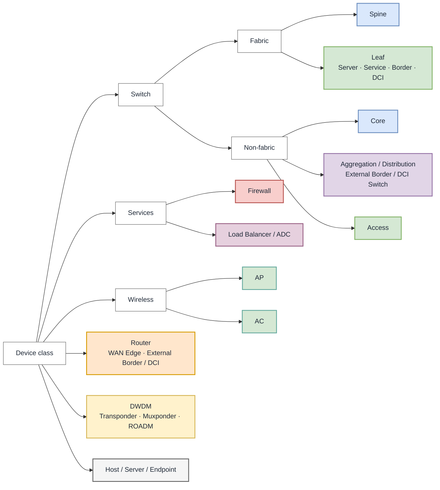

# Network Topology Figures

Plugin-agnostic content and visual conventions for network topology figures.
Every maintained figure needs an editable canonical source; its implementation
adapter defines the format, validation, export, and publication workflow.

## Purpose, scope, and viewpoint

State the figure's purpose, abstraction level, and one primary viewpoint:

| Viewpoint | Shows |
|---|---|
| Physical | Devices, ports, cables, bundles, sites, and failure domains |
| Logical or control plane | Adjacencies, overlays, tunnels, VRFs, and logical boundaries |
| Service or traffic flow | Service traversal, direction, policy, and ingress/egress paths |

Use `atomic schematic`, `reference architecture`, or `implementation-specific`
as the abstraction level. A hybrid viewpoint must distinguish its layers with
boundaries or a legend. The caption may carry this context to avoid figure clutter.

## Figure anatomy

Every figure needs:

1. A short title.
2. A label on every device or functional node.
3. Boundaries for sites, fabrics, pods, zones, or failure domains when relevant.
4. A legend when color, line style, or shape is not self-explanatory.
5. A numbered caption in the consuming document stating the figure's purpose.

Use layer labels such as `SPINE`, `LEAF`, `WAN`, or `SECURITY SERVICES` when
placement encodes architecture. Omit decoration that adds no topology, role, or
traffic-flow meaning.

## Visual encoding

### Device cards

Represent a network device with a labeled rectangular **device card**. Always write the
device role; shape and color are secondary cues.

```text
┌────────────────────────┐
│ Spine 1                │  Role or logical name
│ DC1-SP01               │  Hostname or model, when relevant
│ ASN 65001 · VRF PROD   │  Relevant context, when needed
└────────────────────────┘
```

Card detail is **minimal** (role), **identified** (role plus hostname or model), or
**detailed** (only the interfaces, ASNs, addresses, or platform facts the figure needs).
Put a model on a second line in a smaller font (see Sizes and spacing). Put interface
names beside their link endpoints, not in the card. Where tenants and VRFs go depends on
the layout; see Layout. Never paste configuration.

### Classification and color

Classify a node as `device class → fabric membership (switches only) →
architectural role → functional qualifier`.

| Device class | Domain | Architectural role | Functional qualifier / label | Preferred representation | Fill / stroke |
|---|---|---|---|---|---|
| Switch | Fabric | Spine | `Spine 1` | Rectangular device card | Blue `#DAE8FC` / `#6C8EBF` |
| Switch | Fabric | Leaf | `Server Leaf 1`, `Service Leaf 1`, `Border Leaf 1`, `DCI Leaf 1` | Rectangular device card | Green `#D5E8D4` / `#82B366` |
| Switch | Non-fabric | Core | `Core 1`, `Collapsed Core 1` | Rectangular device card | Blue `#DAE8FC` / `#6C8EBF` |
| Switch | Non-fabric | Aggregation or distribution | `Aggregation 1`, `Distribution 1`, `External Border Switch 1`, `External DCI GW 1` | Rectangular device card | Purple `#E1D5E7` / `#9673A6` |
| Switch | Non-fabric | Access | `Access 1` | Rectangular device card | Green `#D5E8D4` / `#82B366` |
| Router | External routed domain | Router | `Router 1`, `WAN Edge 1`, `External Border Router 1`, `External DCI GW 1` | Rectangular device card | Orange `#FFE6CC` / `#D79B00` |
| DWDM | Optical transport | Optical system | `DWDM 1`, `Transponder 1`, `Muxponder 1`, `ROADM 1` | Rectangular device card | Yellow `#FFF2CC` / `#D6B656` |
| Firewall | Security or service layer | Firewall | `Firewall 1`, `Virtual FW 1` | Rectangular device card | Red `#F8CECC` / `#B85450` |
| Load balancer | Service layer | Load balancer or ADC | `LB 1`, `Virtual LB 1`, `GSLB 1` | Rectangular device card | Pink `#E6D0DE` / `#996185` |
| AP | Wireless access | Access point | `AP 1` | Compact rectangular device card | Turquoise `#D5E8D4` / `#67AB9F` |
| AC | Wireless control | Access controller | `AC 1`, `Virtual AC 1` | Rectangular device card | Turquoise `#D5E8D4` / `#67AB9F` |
| Host, server, or endpoint | Attached workload | Endpoint | Hostname or workload role | Rounded endpoint card | Gray `#F5F5F5` / `#666666` |
| Network or provider domain | Abstract external domain | WAN, Internet, or provider network | Provider or service name | Cloud or bounded domain | Gray `#F5F5F5` / `#666666` |

This Mermaid preview makes the taxonomy and palette visible in Markdown. It is
not the canonical source format for maintained figures.



Classification notes:

- Color reinforces labels and may be overridden only with a legend. Preserve readable
  text and borders in light and dark themes.
- Firewalls, load balancers, APs, and ACs keep their classes regardless of attachment
  or physical/virtual deployment.
- A cloud represents an abstract domain, not a router. Put vendor/platform identity in
  text; vendor icons may decorate but never replace the role label.
- DWDM is optical transport. Keep it separate from the connected packet switch or
  router.
- **A border leaf is still a leaf**, and a controller-managed DCI leaf stays a leaf.
- Outside the fabric, classify a border or DCI gateway by device: an aggregation switch
  or a router. Never label either as a `DCI Leaf`.
- **"IPN" is an ACI term; the inter-site card depends on the platform.** In Cisco ACI
  the IPN is a separate routed underlay that belongs to no single fabric: draw it as an
  aggregation-tier card outside the fabric's boundary, never as a leaf, and keep the
  label `IPN` (see [skills/vendor-matrix/cisco/aci.md](../skills/vendor-matrix/cisco/aci.md)).
  Huawei CloudFabric has no IPN: the same function is a **DCI leaf** that belongs to one
  specific fabric, so draw it as a leaf inside the boundary that bounds that fabric and
  label it `DCI leaf`. The solution documentation also calls the node a DCI gateway or
  fabric gateway (see
  [skills/vendor-matrix/huawei/cloudfabric.md](../skills/vendor-matrix/huawei/cloudfabric.md#dci-gateway-role)).

### Sizes and spacing

Card size is a house convention, not a tool requirement. Two presets cover the figures
in this library; sizes are in draw.io units.

| Preset | W × H | Label | Applies to |
|---|---|---|---|
| Small | 45 × 32 | 10 pt; 9 pt with a 7 pt model line | Leaf switches (server, service, border, DCI), WAN and edge routers, hosts (storage arrays, bare-metal servers, hypervisor hosts) |
| Medium | 68 × 32 | 11 pt; 10 pt with a 7 pt model line | Spine switches, aggregation and distribution switches, firewalls, DWDM and other optical systems, core routers, load balancers, the ACI IPN |
| Boundary | Container | 14 pt bold, label in the top-left corner | One solid boundary per site, one dashed boundary per fabric or region nested inside it |

Two router roles sit on either side of the line: a WAN or edge router normally carries a
single ISP uplink and takes the small card, while a core router fans out to many links and
takes the medium one.

- **Shrink the font, not the card.** When a label or a model line does not fit, step the
  role font down one point for every card in the figure, as the table shows. Change a
  preset only when the label still does not fit, and then change it for that role
  everywhere. Never widen a preset to fit a model name. If a model applies to a whole
  group rather than one role (for example several fabric switch models), put it on the
  group's boundary label instead.
- **One preset per role.** Never mix presets within a row, except where a lone role
  still needs the wider card after the font has been shrunk.
- **Spacing:** 6 units between the two switches of a pair, 14 units between pairs, and
  at least 16 units between a container and the cards inside it.
- **A card alone under a switch pair is centred on the pair's midline**, not under one
  of the two switches — a load balancer under a leaf pair, for example.

### Layout

Rules for every figure come first, then rules for the physical and logical viewpoints
defined in Purpose, scope, and viewpoint. Only these rules are general. Other layout
choices, such as switch pairs by default, a balanced leaf row, one boundary per meaning,
one centre axis, or mirroring a second identical site, are per-figure options: offer
them, don't impose them.

- **Link to the facing edge, not the centre line.** Leave the upper card's bottom-centre
  and land on the lower card's top-centre; for side-by-side cards use right-centre to
  left-centre the same way. Without an anchor the renderer aims at the target's centre,
  so a link into a row of cards has already dipped into the row's band before it arrives
  and crosses the top corners of the cards in between — the reason a spine-leaf fan can
  look like it attaches to the wrong leaf. Spine-leaf figures are rows of cards with
  links drawn between the facing edges. The adapter gives the anchor syntax.
- **Keep links off label text.** No link crosses a boundary's label. Place a card that a
  link enters from above to the side of its container's label. In a narrow container,
  wrap the label onto as many lines as it needs. Otherwise indent the container so the
  label sits clear of the links that pass it.
- **Spines above the leaves; where border leaves go depends on the platform.** Draw the
  server and service leaves in a single row beneath the spines. In Cisco ACI the border
  leaves stay in that leaf row, never in a row above the spines. In Huawei CloudFabric
  the border leaves sit in a row above the spines, facing the firewall or external
  router they connect to.
- **Each site has its own inter-site pair, facing the other site.** Whether it is an IPN
  or a DCI leaf pair, every data center gets its own pair, linked to the other sites'
  pairs; never draw one pair shared between sites. Stack its two cards on one vertical
  axis at the fabric edge that faces the remote data center, with any inter-site
  transport (DWDM) centred on the pair's horizontal midline. It must not sit beside the
  spine row, where it reads as another fabric switch.
- **Controllers have no device links.** A controller that manages a whole fabric or
  domain gets no link to any one device or container. Its only line is the dotted one to
  the controller above it. Centre shared management (for example a multi-site controller
  and the policy managers it reads) between the sites it serves.

#### Physical layout (underlay)

The physical viewpoint; in an SDN figure, the underlay.

- **Logical resources as text, not cards.** A tenant, VRF, or other logical resource is
  not a device. Show it as small gray text, never as a card, next to the device where it
  is configured or sits.
- **Off-path devices beside their attachment.** Place an off-path service device, such as
  a DC firewall on a border-leaf pair, next to that pair. Link it with straight lines,
  without bends, even if that means one crossing of a fabric link.

#### Logical layout (overlay)

The logical viewpoint; in an SDN figure, the overlay.

- **Logical resources are the objects.** Draw a tenant, VRF, or other logical resource in
  card compartments (one per VRF or interface group) or as its own boundary.

## Link and traffic semantics

| Style | Meaning |
|---|---|
| Solid, no arrowhead | Physical link; bidirectional unless labeled otherwise |
| Dashed with arrowhead | Traffic path and direction; two paths when forward and return differ |
| Dotted | Logical adjacency, tunnel, control-plane session, or controller relationship |
| Original style in red, with a red ✖ on it | Failed, blocked, or rejected connection or path |

A tunnel that carries traffic drawn on top of it may instead be one wide translucent band
from endpoint to endpoint. Draw the band over the devices and networks it passes through
but does not terminate on, and fade those devices, so the band reads as passing over them.
End the band on the devices that terminate the tunnel. A tunnel that is down keeps its
route and is drawn faint gray.

Reserve dashed lines for traffic. Express standby, optional, preferred, inferred,
or out-of-scope status with text or a legend. Use arrows only when direction
matters; double-ended arrows mean bidirectional traffic.

Place interface names at their physical-link endpoints, shared speed/media/bundle
properties near the solid-line center, and VRF/tenant/application/policy labels
on the dashed path. A dashed path's label may also name the route that decides that hop,
such as `0.0.0.0/0 static` or `BGP /32`.

A VRF or tenant label on a dashed path names the traffic's VRF or tenant, in either
layout. It does not replace the gray text that shows where the resource is configured in
a physical layout. In a logical layout, label a path only where it crosses from one VRF
or tenant boundary to another.

## Rules by document type

| Document | Figure requirements |
|---|---|
| POC record | The topology under test; relevant names, interfaces, addresses, VLANs, exercised links, failure actions, and failure paths. Never publish an inferred or unlabeled POC figure. |
| Scenario | Abstract reference architecture with functional roles and boundaries; omit customer-specific details. |
| Technique | Atomic schematic teaching one structure or mechanism; use generic roles unless the implementation is inherently vendor-specific. |

## File placement, naming, and references

- Preserve the editable canonical source beside its consuming document unless
  the implementation adapter requires another layout.
- Name it `<topic>-figN.<native-source-extension>` in lowercase.
- Publish previews/exports according to the adapter's policy.

### Self-describing source

A generator or script that produced the source is disposable, so the source must carry
the figure's structure, not just its appearance:

- Regions nest by containment: a card belongs to the fabric or site boundary that
  contains it, not one that merely overlaps it.
- Every relationship is a link attached to the two items it connects.

A reader or tool must be able to recover the region tree, the adjacencies, and each
node's role from the source alone, and regenerate the figure from it.

### Markdown figure-reference contract

Reference each maintained figure from its consuming Markdown document with one
standalone link to the editable canonical source:

```markdown
[Figure 1 — Two-spine, four-leaf Clos fabric](spine-leaf-clos-fig1.drawio)
```

The reference is both the source link and the publication marker. Apply these
rules so local reading and automated publication remain deterministic:

- Put exactly one figure reference on a line, with a blank line before and after
  it. Do not place the reference inside prose, a list, a table, or another link.
- Treat fenced code blocks and inline code as examples, never as figure
  references. Publication tooling must leave their contents unchanged.
- Write the link text as `Figure N — <short caption>`, using the figure number
  assigned by the consuming document.
- Use a relative path to the editable canonical source. Never reference a
  generated preview or export from source Markdown.
- One reference identifies one published figure. Prefer a single diagram page
  for that source; when a multi-page source is necessary, the implementation
  adapter must define how its pages are rendered and labeled.
- Keep explanatory prose outside the reference line. The short caption states
  the figure's purpose.

An implementation adapter may replace this marker in a generated publication
tree with a rendered image and a separate editable-source link. It must not
rewrite the canonical Markdown document or commit generated presentation assets
beside it.

### Figure–document correspondence

A figure carries no mapping to its document; the reference is the only binding, so the
consuming document is the source of truth for every name and value the figure shows.

- Take card names and each site's values (ASNs, addresses, VLANs) from the document's
  entries for that site. Give each member of a pair its own card and its own name
  (`Leaf1-1`, `Leaf1-2`).
- The legend explains the visual encoding only. Design interpretation stays in the
  document's text.

## Authoring and validation lifecycle

1. State purpose, viewpoint, and abstraction level.
2. Read the active implementation adapter and edit its canonical source.
3. Inspect topology and labels; run format and figure-specific validation.
4. Verify adjacencies, redundancy, failure domains, traffic direction, and
   figure–document correspondence.
5. Publish the reference/caption and revalidate whenever a fact the figure shows
   changes.

Mechanical checks cannot prove architectural correctness; the author remains
responsible for the figure's meaning.
