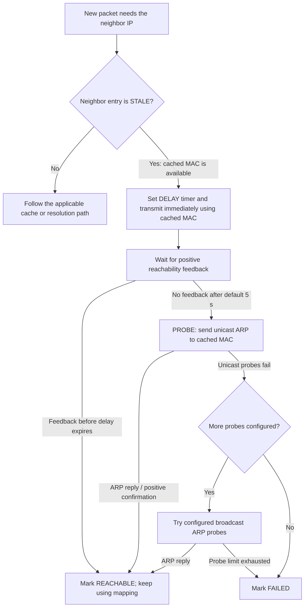

# ARP (Address Resolution Protocol)

For IPv4 over Ethernet, ARP resolves an on-link IPv4 address to a MAC address
[1]. In a fabric, ARP forwarding, suppression, and gateway-generated requests
affect endpoint learning and broadcast traffic [2], [8].

## Protocol basics

### ARP exchange and learning — RFC 826

ARP operates within a logical broadcast domain (VLAN / BD). An initial
IPv4 address-resolution exchange over Ethernet normally proceeds as follows [1]:

1. **Sender broadcasts an ARP Request**: destination MAC `ff:ff:ff:ff:ff:ff`,
   containing the sender's own MAC+IP and the target IP to resolve.
2. **Target unicasts an ARP Reply**: sent directly to the requester's MAC,
   containing the target's MAC.
3. **Conditional sender learning**: RFC 826's receive algorithm updates an
   **existing** entry for the sender before checking the target IP. It creates
   a new sender entry when the receiver is the target. It does **not** require
   every non-target receiver to create a new entry for every broadcast sender
   [1].

### L2 forwarding — IEEE 802.1Q

Bridge forwarding is specified by IEEE bridging standards, not by ARP. In
IEEE Std 802.1Q-1998, §8.11.8, Table 8-5 specifies **Forward** when neither
an applicable static override nor a dynamic entry determines otherwise for
an individual destination MAC. Combined with the eligible-port, topology,
and VLAN rules (§8.7.1–8.7.2 and §8.11.9), this is the baseline
unknown-unicast flooding behavior: forwarding on eligible VLAN ports rather
than originating ARP to find the destination [14].

Filtering rules can restrict the eligible forwarding ports [14].

### L3 forwarding — RFC 826 and RFC 1812

For IPv4 forwarding over Ethernet, distinguish a missing route from a missing
IP-to-MAC binding. Route selection identifies the on-link next hop: the final
destination if directly attached, otherwise an intermediate router. RFC 826's
Packet Generation procedure initiates ARP when the required binding is absent
[1], [13].

RFC 1812 §3.3.2 says the link layer **MUST NOT** report Destination Unreachable
solely because its ARP cache lacks an entry; it **SHOULD** briefly queue a small
number of datagrams while performing ARP resolution. This is not an unconditional
"MUST ARP every unknown destination IP" rule. A missing destination route and
an unresolved on-link adjacency are different conditions [13].

## ARP in fabric / overlay contexts

The two cases below assume ordinary IPv4 forwarding: same-subnet hosts share
a logical VLAN/BD; different-subnet hosts communicate through a gateway with
a valid route. ARP remains within the relevant logical broadcast domain even
when that domain spans the overlay. A usable cached binding avoids a new ARP
exchange [1], [8], [13].

### ARP gleaning (ACI COOP)

ARP gleaning in ACI is a response to an incoming packet: a **host ARP request**
in the same-subnet case below, or a **routed IP packet** in the different-subnet
case. When the corresponding target-IP lookup misses in COOP, the fabric
generates an ARP request from the BD SVI IP and learns from the response.
A missing endpoint entry alone does not start either workflow [2], [11], [12].

#### L2 — source and destination in the same subnet

The **source host must first send an ARP request** for the destination host's
IP. This happens when the source needs to resolve the destination MAC [1].
The following branches all describe ACI's handling of that received request:

- **ARP Flooding enabled:** flood the original request within the permitted
  BD flood scope. The destination can reply and be learned [11].
- **ARP Flooding disabled, target IP known:** forward the original request
  toward the destination using its IP location, found locally or through
  the spine's COOP database. The destination supplies the ARP reply [11].
- **Host ARP received, ARP Flooding disabled, target IP unknown in COOP:**
  the ingress leaf sends the host's request to the spine proxy. On the
  target-IP lookup miss, the spine drops that original request and triggers
  gleaning. Eligible leaves then generate a **second ARP request**, using
  the BD SVI IP as its sender IP. The destination's reply lets ACI learn it,
  allowing a subsequent ARP request from the source host to reach it. This
  requires BD unicast routing and a configured, deployed subnet covering
  the target IP [2], [3], [11].

**Without a host-originated ARP request, this same-subnet discovery path is
not triggered.** If BD unicast routing is disabled, ARP flooding is implicitly
enabled [2], [11].

An ordinary unicast data frame to a MAC unknown throughout the BD does not
itself trigger ARP gleaning. With **L2 Unknown Unicast = Hardware-Proxy**, a
spine COOP MAC miss drops the frame; with **Flood**, the frame is flooded within
the BD. Delivery alone does not guarantee that the destination transmits a
response and becomes learned [2].

#### L3 — source and destination in different subnets

The **source host** resolves its local gateway's MAC, then sends the IP packet
to that gateway. It does not ARP directly for the remote-subnet destination;
its ARP broadcast stays in the source BD [1], [13]. For ACI-routed delivery:

- **Destination endpoint IP known:** use the learned endpoint information
  to forward toward the destination; no discovery ARP is needed [2].
- **Routed IP packet received, destination endpoint IP unknown in COOP:**
  the packet's spine-proxy IP lookup miss triggers gleaning in the destination
  BD. Leaves with the matching BD subnet deployed generate ARP from that
  subnet's BD SVI IP. The trigger here is the routed IP packet; the source
  host does not need to send an ARP request for the destination IP [2], [3].

Routed-IP gleaning requires destination-BD unicast routing and a deployed
subnet covering the destination. It is independent of **ARP Flooding** and
**L2 Unknown Unicast** settings [2], [3].

In either gleaning case, the spine distributes the glean request using
reserved multicast group **239.255.255.240**. The host must answer the generated
ARP; its attaching leaf then learns the endpoint and reports it to COOP.
Multiple leaves can have the pervasive SVI deployed. The reserved glean group
is distinct from a per-VRF GIPo [2], [3].

See [cisco/aci.md](../vendor-matrix/cisco/aci.md#silent-host-detection-arp-gleaning--gipo-tree)
for additional ACI workflow details. The host-ARP trigger described here is
explicit in Doc 222179's ARP Gleaning Use Case 1 [11].

### Huawei SDN (BGP EVPN)

Huawei uses **BGP EVPN MAC/IP Advertisement (Type 2) routes** to distribute
learned endpoint information [15]. The following describes standard ARP and
EVPN behavior for same-subnet and different-subnet communication [1], [8], [13].

#### L2 — source and destination in the same subnet

The **source host** sends ARP for the destination host's IP [1]. Distinguish
the target binding from the handling of an unknown MAC data frame:

- **Target IP-to-MAC binding known:** suppression can avoid flooding. RFC 9161
  defines proxy replies and selective unicast forwarding of the original
  request; Huawei's EVPN overview describes cached-binding replies [8], [15].
  The applicable mode and configuration determine which action is used.
- **Target binding unknown:** the fabric needs a discovery exchange. RFC 9161
  §3.6 normally floods an unresolved ARP request within the BD, subject to
  configured suppression policy [8]. The destination's reply lets its
  attaching PE learn the endpoint and advertise its reachability [15].

Once the source has the destination MAC, missing MAC forwarding state is an
**unknown-unicast** condition. Ordinary bridge forwarding follows the L2 rules
in Protocol basics; an ARP-suppression cache miss and an unknown-MAC data
frame are separate events [8], [14].

#### L3 — source and destination in different subnets

The **source host** resolves its local gateway, rather than the remote host.
For final delivery on the destination subnet, the **gateway serving that
subnet** needs the destination IP-to-MAC binding [1], [13]:

- **Usable binding and forwarding information present:** deliver using that
  information; there is no need for an initial discovery ARP [1].
- **On-link destination binding absent:** the gateway performs ARP resolution
  in the destination BD. That gateway-originated request can traverse the
  extended L2 domain to reach the host. A route identifying the destination
  subnet/next hop is required first [1], [13].

Gateway neighbor resolution is standard protocol behavior [1], [13]. EVPN
distributes the resulting learned bindings [15]. The applicable EVPN IRB
discovery requirements and subnet-route workflow are described in
[evpn.md](evpn.md#silent-host-handling--evpn-vs-aci-coop-gleaning).

## ARP active detection (Huawei smart-discover)

In a legacy VLAN network, ARP active detection proactively probes addresses
on the VLAN interface's subnet to find silent devices. It runs periodically,
without waiting for a host ARP request or an incoming data packet to trigger
resolution. A silent device can be learned when it answers a probe [4].

`arp smart-discover enable` turns this on, and `arp smart-discover interval
<interval> count <count>` sets the scan interval and probe count. Recorded
defaults are 1 s and up to 128 probes per interval. Existing ARP entries,
device IPs, and VRRP VIPs are excluded from the scan. The command is documented
for **VLANIF interface view**; VBDIF applicability is unverified [4]. This is a
VLAN discovery feature, separate from the overlay ARP workflows above.

Operational cautions recorded alongside the command: smart-discover can slow
ARP learning when hosts already send ARP proactively, the probe load is
non-trivial on a small subnet, and a nonresponding address may be probed
indefinitely [4].

**Verification status (2026-10-16):** the cited command page could not be
revalidated — the fetch MCP refused it under robots policy and web retrieval
returned HTTP 403. Everything in this subsection is therefore a historical
library note, not confirmation against the current V300 release; verify the
enable syntax, numerical defaults, and VLANIF/VBDIF applicability against the
release in scope [4].

## Aging and refresh

ARP retention and MAC aging run on independent clocks. This section records the
standards and defaults, how a Linux host behaves when an entry goes stale, and how
fabrics keep learned endpoints alive.

### Aging and reachability standards

Address-resolution and forwarding-state aging have different levels of standardization:

- **MAC (FDB) aging.** IEEE 802.1Q-2005 describes expiration of dynamic
  filtering entries after the configured interval since creation or the
  last eligible learning update. Its Table 8-3 gives a recommended default
  of **300 s** and a range of 10–1,000,000 s. Learning uses an individual
  source MAC and is subject to ingress rules and port state; group source
  addresses are not learned. Static filtering entries do not expire through
  dynamic aging [5].
- **IPv4 ARP aging — no standard value.** RFC 826 suggests but does not
  require a timeout mechanism [6]. RFC 1122 §2.3.2.1 is normative that
  implementations MUST provide a mechanism to flush out-of-date ARP cache
  entries, and that if it is a timeout it SHOULD be configurable — but no
  value is mandated; for proxy-ARP environments RFC 1122 suggests timeouts
  "on the order of a minute" [6]. RFC 1122 also requires a mechanism to
  prevent repeated high-rate requests and recommends a maximum of one
  request/second per destination; that numerical recommendation is distinct
  from the mandatory flood-prevention mechanism and from aging [6]. Cache
  validation and retention depend on implementation and configuration.
- **IPv6 ND reachability.** RFC 4861 §10 defines protocol constants:
  REACHABLE_TIME 30,000 ms, RETRANS_TIMER 1,000 ms,
  DELAY_FIRST_PROBE_TIME 5 s, MAX_MULTICAST_SOLICIT / MAX_UNICAST_SOLICIT 3,
  with ReachableTime randomized by 0.5–1.5× BaseReachableTime [7]. The
  Neighbor Unreachability Detection state machine includes REACHABLE,
  STALE, DELAY, and PROBE. These are reachability states, not a fixed cache
  deletion schedule. Router Advertisements can supply Reachable Time and
  Retrans Timer values; §5.3 treats unused-entry garbage collection
  separately [7].

### ARP and MAC timer reference

The table records timer definitions and documented defaults. Configured
values can override these defaults.

| Platform / standard | Timer | Documented default | Meaning |
|---|---|---|---|
| IEEE 802.1Q | Dynamic MAC aging | 300 s | Time since the filtering entry was last updated [5]. |
| Cisco Nexus 9000, NX-OS 10.6(x) | ARP timeout | 1500 s (25 min) | Dynamic ARP timeout [9]. |
| Cisco IOS XE | `arp timeout` | 14400 s (4 h) | Dynamic ARP cache expiration setting [18]. |
| Arista EOS 4.36.2F | `arp aging timeout` | 14400 s (4 h) | Dynamic ARP cache aging [19]. |
| Arista EOS 4.36.2F | `mac address-table aging-time` | 300 s (5 min) | Dynamic MAC aging since the last frame received from that MAC on its VLAN [19]. |
| Junos OS | ARP `aging-timer` | 20 min (1200 s) | Interval between ARP updates [20]. |
| Huawei CloudEngine V300R026C00 | `arp timeout` | 1200 s (20 min) | Dynamic ARP aging time, set per interface including VBDIF; range 1–86400 s [28]. |

The two timer families are independent: address-resolution retention is an L3
concern, MAC aging is an L2 filtering-database concern, and no standard ties one
to the other. Where the resolution entry outlives the forwarding entry, a
sender's cached IP-to-MAC binding keeps naming a MAC the bridge has already aged
out, and those frames become unknown unicast — normally forwarded on eligible
VLAN ports [14], but dropped where an overlay's unknown-unicast policy drops
rather than floods. Cisco documents the non-overlay case in a campus VLAN network
with asymmetric routing and HSRP, together with the engineering mitigation of
bringing the two aging times closer so that ARP traffic refreshes MAC learning
before the forwarding entry expires [16]. That mitigation is an operational
practice, not a protocol requirement; for a host that never transmits on its own,
see [§Keeping a receive-only host learned](#keeping-a-receive-only-host-learned).

### Linux ARP cache retention

For Linux, `base_reachable_time_ms` is a **neighbor reachability timer, not an
ARP aging timer**. Its 30-second default (randomized to 15–45 seconds) controls
how long positive reachability confirmation is used before the neighbor can
become STALE. Becoming STALE does not delete the ARP entry. When a packet
needs that STALE entry, Linux enters DELAY and sends the packet using its
cached MAC address. It does not wait for a new ARP reply before sending that
packet [26].

After the default `delay_first_probe_time` of 5 s, if no positive feedback
arrived, Linux sends unicast ARP probes to the cached MAC. The default is up
to three unicast probes, one second apart; if they fail, broadcast probes
may follow (up to three by default). A reply restores REACHABLE; exhaustion
of the configured probes makes the entry FAILED [17], [26].

Entry deletion is a separate process. The upstream `gc_stale_time` default is
**60 s**; it makes sufficiently unused entries eligible for periodic garbage
collection, subject to the conditions below. It is not a fixed lifetime
measured from the initial ARP reply [25], [26].

Periodic GC skips collection when the neighbor table has fewer entries than
`gc_thresh1` (default **128**). Active references and protected entry flags
also prevent collection. Consequently, an unused STALE entry may remain
beyond 60 s. Periodic GC can also reclaim FAILED entries, while
pressure-triggered GC uses additional removal criteria [25], [26]. Check the
target interface's settings and kernel version when recording observed
retention; neither the 30 s reachability base nor the 60 s GC eligibility
setting guarantees deletion [17], [25].

The packet path below starts when a new packet needs a neighbor entry that is
already STALE. It shows reachability validation; `gc_stale_time` and entry
deletion are separate from this path:

#### Transport-layer effect: UDP versus TCP

Neighbour resolution itself is protocol-agnostic — the neighbor table is
per-address-family, and the state machine above runs identically whatever the
L4 payload is. What differs is whether the upper layer notices the loss or
recovers from it:

- **Positive feedback is what keeps an entry confirmed.** A successful TCP ACK
  counts as positive feedback; protocols without one must signal progress
  explicitly with `MSG_CONFIRM` on `sendmsg`. Ordinary UDP traffic does neither,
  so it gives the kernel no reason to hold the entry REACHABLE and re-enters the
  DELAY/PROBE path; `arp(7)` records the same effect for kernel protocols such
  as NFS over UDP [17].
- **A datagram sent from a STALE entry is not held back.** Linux transmits it
  immediately using the cached MAC. If that MAC is still correct the datagram is
  delivered and a background probe re-confirms the entry; if it is wrong the
  datagram is lost, and UDP has no retransmission to cover it — a TCP flow
  instead recovers once probing resolves the correct MAC [17], [26].
- **With no usable entry, the queue is small and the overflow is silent.**
  Packets for an unresolved address are queued per destination up to
  `unres_qlen` (default **3** packets), and resolution requests are sent only
  while data is queued. A UDP source that outruns resolution (syslog, flow
  exports) has its overflow dropped with no back-pressure, whereas a TCP
  connection absorbs the same window in retransmission and socket buffering
  [17].
- **Failure is reported asynchronously, if at all.** Linux passes fatal errors
  to the application even on an unconnected UDP socket, and the error may belong
  to an earlier datagram sent over that socket; `udp(7)` notes this is required
  by RFC 1122. A fire-and-forget sender that ignores `sendto()` returns
  therefore observes nothing [27].
- **Broadcast and multicast destinations bypass resolution entirely.** They use
  the `NUD_NOARP` pseudo-state, which performs no address resolution or NUD, so
  stale ARP state and `unres_qlen` do not apply to them [26].

### Endpoint aging and refresh in overlays

RFC 9161 §3.5 describes optional probes to refresh **known local dynamic
bindings** before bridge-table and proxy-table aging causes unnecessary
Type 2 withdrawals. A reply refreshes both entries; failure to reply leads
to removal and withdrawal [8]. NX-OS also documents an optional ARP refresh
on MAC deletion [9]. These are maintenance of learned bindings, separate
from initial discovery of an unknown endpoint.

### Keeping a receive-only host learned

A host that only receives, such as a UDP syslog collector, sends nothing that
refreshes its MAC in the fabric. Where the overlay drops unknown unicast, the timer
mismatch in [§ARP and MAC timer reference](#arp-and-mac-timer-reference) and the
Linux STALE behavior in [§Linux ARP cache retention](#linux-arp-cache-retention) turn
into silent loss: senders keep transmitting to the aged-out MAC, the fabric drops
those frames, and UDP reports nothing (see [§Transport-layer
effect](#transport-layer-effect-udp-versus-tcp)).

Check first that the service really is receive-only. A TCP listener answers a SYN
with SYN,ACK, and that frame teaches the fabric its MAC [29].

**Make the gateway's ARP aging the refresh clock.** If the subnet's gateway (Huawei
VBDIF, an SVI or an IRB interface) holds a dynamic ARP entry for the host, it probes
that entry when the entry's aging time expires. A reply updates the entry; if no reply
arrives after the configured number of probes, the entry is deleted [28]. The host's
reply is a frame from its own MAC at the attaching leaf, so it also refreshes the FDB
entry [5] and keeps the EVPN Type 2 binding alive. This is the age-out probing of a
previously learned host that RFC 9135 §7.3
describes (see [evpn.md](evpn.md#silent-host-handling--evpn-vs-aci-coop-gleaning)).

- **Timing rule:** set the gateway's ARP aging time well below the MAC aging time,
  for example 150 s against the 300 s default. On CloudEngine this is `arp timeout`
  on the VBDIF, whose default of 1200 s is far above the MAC aging time [28]. A
  unicast probe sent after the FDB entry has expired is itself unknown unicast and is
  dropped, so the probe must land while the entry still exists.
- **Probe mode:** the CloudEngine command reference gives the default as unicast
  probes with only the last one broadcast, and `arp detect mode unicast` makes all of
  them unicast. The same library's concept page says broadcast is the default.
  Confirm the mode on the device before relying on it [28].
- **The gateway must already hold a dynamic entry.** Aging probes fire only for
  existing entries. Same-subnet traffic never routes through the gateway, so the
  entry may never be created; a routed admin session creates one only as a side
  effect. Seed it, or let the gateway discover it (see
  [§ARP active detection](#arp-active-detection-huawei-smart-discover)).
- **A static ARP entry can't do this.** Aging probes belong to the dynamic-entry
  aging mechanism, and a static entry isn't changed by ARP messages [28], so it
  produces no probe and no reply.

**Other options:**

- **Keep broadcast ARP flooding while dropping unknown unicast.** A Linux sender
  whose entry fails falls back to broadcast probes, which reach the host, and its
  reply re-teaches the fabric [17]. Datagrams are lost until then, so treat this as
  the recovery path, not the design.
- **Pin the binding** only for a host that can't answer ARP at all (see
  [§Design considerations](#design-considerations)).

## Cross-vendor / variants

| Vendor | ARP handling | ARP generation | Notes |
|---|---|---|---|
| **Cisco ACI** | Known-target forwarding optimization via COOP | Reactive gleaning | In the host-ARP path, receipt of an ARP request with ARP Flooding disabled can trigger gleaning on a target-IP COOP miss. Routed-IP gleaning is a separate trigger [2], [11]. |
| **Cisco NX-OS EVPN** | ARP suppression (`suppress-arp` under VNI) | Gateway resolution and optional MAC-delete refresh; no ACI COOP workflow | A suppression miss floods the original ARP. NX-OS 10.6(x) also documents gleaning and optional refresh; verify IRB mode and feature prerequisites [9], [10]. |
| **Arista EOS** | EVPN L2 ARP proxy; mode/configuration determines handling [21] | Gateway-generated ARP in routed designs | Arista publicly documents post-routing VXLAN glean ARP replication [21]. |
| **Juniper Junos** | EVPN proxy ARP and suppression [22] | Gateway resolution; configured `static-mac-ip` probing is an additional feature | A matching host response to a configured-binding probe causes learning and Type 2 advertisement; `arp-nd-probe-disable` controls this probing [22]. |
| **Huawei CloudEngine** | EVPN binding-based suppression; proxy reply or selective forwarding according to mode [8], [15] | Gateway ARP resolution | See §Huawei SDN (BGP EVPN) for overlay L2/L3 behavior. Legacy VLAN active detection is covered separately above [4]. |

**NDP (IPv6 Neighbor Discovery Protocol)** provides IPv6 neighbor resolution
(RFC 4861). EVPN proxy ND is covered by RFC 9161 [8]; the ACI packet-level
gleaning discussion above is specifically IPv4 ARP and must not be used to
assert identical IPv6 implementation behavior. IPv6 multicast address resolution
uses solicited-node multicast groups; reachability probes may instead use
unicast Neighbor Solicitations [7].

## Design considerations

- **Size the ARP broadcast scope and load.** Suppression or selective
  forwarding can reduce flooding for known targets. Unknown-target requests
  normally still need a discovery exchange; evaluate the BD membership,
  actual request rate, and flood policy [8], [10].
- **Separate quiet from ARP-deaf.** A host that never initiates application
  traffic can still answer ARP and be discovered. A UDP listener or static
  neighbor cache alone does not establish that the host ignores ARP requests.
  Host-originated ARP, flooded requests, and ACI gleaning are possible discovery
  paths; static bindings are not the general prerequisite [1], [2].
- **Separate bridge-only forwarding from gateway functions.** An L2-only VTEP
  has no local routed-IP glean adjacency for that subnet. This does not prove
  the absence of a snooped MAC/IP suppression cache or proxy behavior. An
  external or centralized gateway can still send ARP through the L2 overlay.
  For ACI BD-SVI gleaning, unicast routing and a deployed destination BD subnet
  are required [2], [3]. Separately, RFC 9161 §3.5 permits refresh of **known
  local dynamic proxy bindings** with ARP sender IP 0 if the PE has no subnet
  IP. That is not arbitrary unknown-IP discovery and does not require the
  PE to be the default gateway [8].
- **Gateway ARP and proxy ARP are distinct.** A local gateway can answer ARP
  for its own configured IP. Proxy suppression answers for another endpoint's
  known binding. These are separate address-resolution functions [1], [8].
- **Static state for genuinely nonresponding hosts.** If a live host cannot
  answer ARP, an explicitly provisioned IP-to-MAC binding and a usable MAC
  forwarding path may be needed. A static ARP entry alone does not establish
  an attachment or guarantee EVPN advertisement. No static entry can make a
  powered-off host respond [1].

## Relationship to other techniques

- [evpn.md](evpn.md): EVPN Type 2 routes carry MAC↔IP bindings that drive ARP
  suppression; ARP flooding vs. suppression is a primary EVPN design decision.
- [vxlan.md](vxlan.md): VXLAN carries flooded ARP across a logical BD;
  suppression and flood policy determine which requests are replicated [8].
- [ai-gpu-fabric.md](ai-gpu-fabric.md): RoCEv2 carries RDMA over UDP/IP on
  Ethernet. Its IPv4 traffic still needs on-link IP-to-MAC resolution;
  RDMA queue-pair identifiers do not replace Ethernet addressing [1], [23].
- [fhrp.md](fhrp.md): VRRP answers IPv4 gateway ARP with the virtual router
  MAC [24]. An EVPN anycast gateway also answers ARP for its gateway IP;
  using an anycast gateway does not eliminate host ARP resolution [1], [2].

## References

[1] D. C. Plummer, "An Ethernet Address Resolution Protocol," IETF RFC 826,
November 1982. [Online]. Available: https://www.rfc-editor.org/rfc/rfc826.txt —
the normative ARP specification. Defines the Request/Reply exchange, bidirectional
conditional sender-entry update/creation and Request/Reply processing. Receive
algorithm rechecked via doc-fetcher Oct. 16, 2026.

[2] "Cisco ACI Fabric Endpoint Learning White Paper," Cisco, updated June 9,
2026; stated feature scope through 5.2(1g). [Online]. Available:
https://www.cisco.com/c/en/us/products/collateral/networking/cloud-networking/application-centric-infrastructure/fabric-endpoint-learning-wp.html
— verify "Silent hosts considerations," "Aging of endpoints," and "Local
endpoints and remote endpoints." Rechecked Oct. 16, 2026; latest page date
does not prove coverage of later software releases.

[3] "Troubleshoot ACI Intra-Fabric Forwarding — MultiPod Forwarding," Cisco
Support, Doc ID 218013. [Online]. Available:
https://www.cisco.com/c/en/us/support/docs/cloud-systems-management/application-policy-infrastructure-controller-apic/218013-troubleshoot-aci-intra-fabric-forwarding.html
— COOP database lookup,
reserved glean group 239.255.255.240 and leaf-generated ARP from the BD SVI.
Verify "Proxied requests where the EP is not in COOP," "Glean ARP verification,"
and "Other possible causes." Rechecked Oct. 16, 2026.

[4] "ARP Configuration Commands — CloudEngine 9800, 8800, and 6800
V300R024C00 Command Reference," Huawei, EDOC1100439391. [Online]. Available:
https://support.huawei.com/enterprise/en/doc/EDOC1100439391/1c40b472/arp-configuration-commands
— `arp smart-discover enable` in VLANIF interface view, ARP active detection
for proactive silent-host learning. Previously recorded Aug. 2026; current
recheck Oct. 16, 2026 blocked by robots policy/HTTP 403. Current command
applicability and numerical defaults remain unverified.

[5] "IEEE Standard for Local and Metropolitan Area Networks — Bridges and
Bridged Networks," IEEE Std 802.1Q-2018 (incorporates 802.1D bridging,
Clause 8.8 filtering database). [Online]. Available: https://ieeexplore.ieee.org/document/8403927;
also IEEE Std 802.1Q-2005, Clause 8.8.3/8.8.4 (text verified from a copy
of the 2005 edition, Aug 2026): dynamic entries are "created and updated by
the Learning Process (8.7)" and "shall be automatically removed after a
specified time, the Ageing Time, has elapsed since the entry was created
or last updated"; static entries "shall not be automatically removed by
any ageing mechanism"; Table 8-3: Ageing time recommended default 300.0 s,
range 10.0–1,000,000.0 s. Non-changeable standard.

[6] R. Braden, Ed., "Requirements for Internet Hosts — Communication
Layers," IETF RFC 1122, October 1989, §2.3.2.1. [Online]. Available:
https://www.rfc-editor.org/rfc/rfc1122.txt — ARP cache validation: MUST
flush out-of-date entries; timeout SHOULD be configurable; RFC 826
"suggests but does not require" a timeout; flood-prevention mechanism is
mandatory, with a recommended maximum of 1 request/s per destination;
proxy-ARP timeout "on the order of a minute." Rate-limit wording rechecked
Oct. 16, 2026.

[7] T. Narten, E. Nordmark, W. Simpson, H. Soliman, "Neighbor Discovery
for IP version 6 (IPv6)," IETF RFC 4861, September 2007, §5.3,
§6.3.2, §7.2–7.3, and §10.
[Online]. Available: https://www.rfc-editor.org/rfc/rfc4861.txt —
REACHABLE_TIME 30,000 ms; RETRANS_TIMER 1,000 ms; DELAY_FIRST_PROBE_TIME
5 s; MAX_MULTICAST_SOLICIT / MAX_UNICAST_SOLICIT 3; ReachableTime
randomized 0.5–1.5× BaseReachableTime; NUD states and probes, Router
Advertisement overrides, and separate unused-cache garbage collection.
Rechecked Oct. 16, 2026.

[8] J. Rabadan et al., "Operational Aspects of Proxy ARP/ND in Ethernet
Virtual Private Networks," IETF RFC 9161, January 2022, §3.2, §3.5–3.6.
[Online]. Available: https://www.rfc-editor.org/rfc/rfc9161.html — proxy tables
learn local snooped and remote EVPN bindings; unknown requests normally flood.
Optional known-binding refresh can use sender IP 0 without an IRB subnet IP;
§3.3–3.4 define proxy reply and selective unicast forwarding.
Verified via doc-fetcher Oct. 16, 2026.

[9] "IPv4 Addresses," Cisco Nexus 9000 Series NX-OS Unicast Routing
Configuration Guide, Release 10.6(x), updated Apr. 27, 2026. [Online]. Available:
https://www.cisco.com/c/en/us/td/docs/dcn/nx-os/nexus9000/106x/configuration/unicast-routing-configuration/cisco-nexus-9000-series-nx-os-unicast-routing-configuration-guide/m-n9k-configuring-ipv4-93x.html
— verify "Glean throttles," "Configuring local proxy ARP on SVIs," and
"Configuring periodic ARP refresh on MAC delete for SVIs," including limitations.
Rechecked Oct. 16, 2026; refresh is optional and triggered by MAC deletion,
not initial unknown-IP discovery.

[10] "Configuring VXLAN BGP EVPN," Cisco Nexus 9000 Series NX-OS VXLAN
Configuration Guide, Release 10.6(x). [Online]. Available:
https://www.cisco.com/c/en/us/td/docs/dcn/nx-os/nexus9000/106x/configuration/vxlan/cisco-nexus-9000-series-nx-os-vxlan-configuration-guide-release-106x/m_configuring_vxlan_bgp_evpn.html
— verify "Configure ARP suppression": a cache miss broadcasts the request
to detect silent hosts. Rechecked via fetch MCP Oct. 16, 2026.

[11] S. Garg, "Understand ARP Flooding and ARP Gleaning in ACI," Cisco TAC,
Doc ID 222179, July 23, 2024. [Online]. Available:
https://www.cisco.com/c/en/us/support/docs/technical-details/222179-understand-arp-flooding-and-arp-gleaning.html
— verify "Understanding ARP Flooding," use cases 3–4, and "Understanding ARP
Gleaning," requirements and use case 1. Same-BD host ARP can trigger IP-based
gleaning when ARP Flooding is disabled. Rechecked Oct. 16, 2026; no specific
current software release is stated.

[12] "ACI Multi-Pod White Paper," Cisco, updated May 9, 2022, discussion
around Figures 35–36 in "Inter-Pods VXLAN Data Plane." [Online]. Available:
https://www.cisco.com/c/en/us/solutions/collateral/data-center-virtualization/application-centric-infrastructure/white-paper-c11-737855.html
— explicitly names fabric-generated ARP from the BD IP as "ARP Gleaning,"
distinguishing it from flooding the original host request. Rechecked
Oct. 16, 2026 as an independent definition source, not validation of all
current-release details in this older paper.

[13] F. Baker, Ed., "Requirements for IP Version 4 Routers," IETF RFC 1812,
June 1995, §3.3.2 and §5.2.4.2–5.2.4.3. [Online]. Available:
https://www.rfc-editor.org/rfc/rfc1812.html — route/next-hop selection precedes
link-layer resolution; an absent ARP entry alone MUST NOT cause immediate
Destination Unreachable reporting, and brief queuing during ARP resolution
is a SHOULD. Verified via doc-fetcher (§3.3.2) and RFC Editor web text
(next-hop sections), Oct. 16, 2026. Does not define ACI COOP behavior or impose
an unconditional ARP probe for every destination lacking a route.

[14] "IEEE Standard for Local and Metropolitan Area Networks: Virtual
Bridged Local Area Networks," IEEE Std 802.1Q-1998, §8.7.1–8.7.2,
§8.11.8, Table 8-5 (printed p. 50), and §8.11.9. [Online]. Available:
https://ptacts.uspto.gov/ptacts/public-informations/petitions/1553870/download-documents?artifactId=78Y7tI10RPvJYukvT-ljHvgTDW0GlSPkQIIQWbUyb9qjisiiKE3zmTs
— published standard reproduced as Arista Networks Exhibit 1008 in
IPR2023-00805, hosted by USPTO. Verified Oct. 16, 2026 from extracted standard
text: absent static/dynamic individual-address information produces Forward;
eligible-port and VLAN rules bound the transmission set. Clause/table numbers
here refer specifically to the 1998 edition, not the current edition.

[15] C. Li and W. Shengnan, "What Is EVPN?," Huawei IP Encyclopedia,
updated Nov. 25, 2024. [Online]. Available:
https://info.support.huawei.com/info-finder/encyclopedia/en/EVPN.html
— verify "Benefits Brought by EVPN," "MAC Address Learning," "Traffic
Forwarding," and "Unicast Traffic Forwarding": MAC/IP advertisements,
cached-binding ARP replies, and flooded ARP/reply learning. Rechecked via
fetch MCP and web retrieval Oct. 16, 2026. General EVPN explanation with
MPLS examples; product commands and defaults are outside its scope.

[16] "Unicast Flooding in Switched Campus Networks," Cisco Support,
Doc ID 23563, updated Feb. 8, 2016. [Online]. Available:
https://www.cisco.com/c/en/us/support/docs/switches/catalyst-6000-series-switches/23563-143.html
— verify "Problem Definition" and "Cause 1: Asymmetric Routing," especially
the campus VLAN/HSRP example and ARP-timeout/MAC-aging mitigation. Rechecked
Oct. 16, 2026. Used to establish the non-overlay mechanism, not current
platform timer defaults.

[17] "arp(7) — Linux ARP kernel module," Linux man-pages 6.19,
Feb. 8, 2026. [Online]. Available:
https://man7.org/linux/man-pages/man7/arp.7.html
— verify "DESCRIPTION" and "/proc interfaces," especially
`base_reachable_time_ms`, stale-neighbor probing, and garbage collection.
Rechecked Oct. 16, 2026. Reachability timing is distinct from a fixed
neighbor-entry deletion timeout; for exact packet handling with a STALE
entry, see the version-pinned implementation in [26]. The same page is the
source for upper-layer feedback (positive feedback from a TCP ACK,
`MSG_CONFIRM` for other protocols), the reprobe order (app-solicit, then
unicast, then broadcast), and the note that requests are sent only while data
is queued. The `unres_qlen` default of 3, `ucast_solicit`/`mcast_solicit`
defaults of 3, and `retrans_time_ms` of 1000 ms were re-verified Oct. 16, 2026
against the Debian manpages rendering of man-pages 6.03 (2022-12-15), because
man7.org was unreachable from this environment (robots.txt fetch failed);
re-confirm the numerals against the current man-pages release.

[18] "Address Resolution Protocol," Cisco IOS XE IP Addressing Configuration
Guide, updated Sept. 28, 2026. [Online]. Available:
https://www.cisco.com/c/en/us/td/docs/routers/ios-xe/ip-addressing/ip-addressing/m_arp-config-arp-0.html
— verify "Setting an Expiration Time for Dynamic Entries in the ARP Cache":
`arp timeout` default 14400 seconds. Rechecked Oct. 16, 2026.

[19] "IPv4" and "Data Transfer," Arista EOS User Manual, live documentation
headed EOS 4.36.2F. [Online]. Available:
https://www.arista.com/en/um-eos/eos-ipv4 and
https://www.arista.com/en/um-eos/eos-data-transfer
— verify "Configuring ARP" / `arp aging timeout` (14400 seconds) and
"Dynamic MAC Address Table Entries — Aging Time" (300 seconds).
Rechecked Oct. 16, 2026.

[20] "arp," Juniper Networks Junos OS CLI Reference, updated May 22, 2026.
[Online]. Available:
https://www.juniper.net/documentation/us/en/software/junos/cli-reference/topics/ref/statement/arp-edit-interfaces.html
— verify `aging-timer` and `interfaces aging-timer`: default interval between
ARP updates is 20 minutes. Rechecked Oct. 16, 2026.

[21] "ARP/ND Learning from Bridged ARP/ND traffic" and "VXLAN Optimized
Headend Replication of Glean ARPs," Arista public TOI ARP index.
[Online]. Available: https://www.arista.com/en/support/toi/tag/arp
— verify the entries dated May 26, 2026 (EVPN L2 ARP proxy/bridged learning)
and Oct. 15, 2024, updated Dec. 12, 2025 (post-routing glean ARP/NS
replication, EOS 4.32.2F). Rechecked Oct. 16, 2026. Detailed feature
configuration/platform restrictions require the corresponding product guide.

[22] "Static Configuration of MAC-IP Bindings" and "EVPN Proxy ARP and ARP
Suppression, and Proxy NDP and NDP Suppression," Juniper Networks,
Junos OS documentation. [Online]. Available:
https://www.juniper.net/documentation/us/en/software/junos/evpn/topics/concept/static-mac-ip.html
and
https://www.juniper.net/documentation/us/en/software/junos/evpn/topics/concept/evpn-proxy-arp-support.html
— verify configured-binding probes, matching-response learning/Type 2
advertisement, `arp-nd-probe-disable`, and proxy-hit/miss handling.
Rechecked Oct. 16, 2026; platform coverage is listed in the documents and
Feature Explorer.

[23] "RDMA over Converged Ethernet (RoCE)," NVIDIA MLNX_OFED Software
documentation, v23.04-0.5.3.3, "RoCE Modes" and "RoCEv2." [Online]. Available:
https://networking-docs.nvidia.com/mlnxofedswum/23040533/rdma-over-converged-ethernet-roce
— protocol-format reference for RDMA carried over UDP/IP and Ethernet;
not a current-driver configuration reference. Rechecked Oct. 16, 2026.

[24] A. Lindem and A. Dogra, "Virtual Router Redundancy Protocol (VRRP)
Version 3 for IPv4 and IPv6," IETF RFC 9568, April 2024, §8.1.2.
[Online]. Available: https://www.rfc-editor.org/rfc/rfc9568.html#section-8.1.2
— the Active Router answers gateway ARP with the Virtual Router MAC address.
Verified Oct. 16, 2026.

[25] "IP Sysctl," Linux kernel documentation, neighbor-cache variables.
[Online]. Available: https://docs.kernel.org/networking/ip-sysctl.html
— verify `neigh/default/gc_stale_time` (60 seconds), `gc_thresh1` (128),
`gc_thresh2`, and `gc_thresh3`: unused-entry eligibility, periodic-GC
thresholds, active-reference/entry-flag exceptions, and pressure behavior.
Rechecked Oct. 16, 2026. These are upstream defaults; interface/distribution
configuration and kernel version can differ.

[26] Linux kernel source, release tag v6.12, `net/ipv4/arp.c` (`arp_tbl`)
and `net/core/neighbour.c` (`__neigh_event_send`, `neigh_timer_handler`,
`neigh_periodic_work`, and `neigh_forced_gc`). [Online]. Available:
https://github.com/torvalds/linux/blob/v6.12/net/ipv4/arp.c and
https://github.com/torvalds/linux/blob/v6.12/net/core/neighbour.c
— version-pinned implementation example: 60-second GC stale-time default,
128-entry minimum threshold, and conditional neighbor removal. Rechecked
Oct. 16, 2026 against the source; current upstream documentation is [25].
Also consulted within the same release tag:
`include/uapi/linux/neighbour.h`, for the `NUD_*` state values and the
`NUD_NOARP`/`NUD_PERMANENT` pseudo-states, which "never change and make no
address resolution or NUD."

[27] "udp(7) — User Datagram Protocol for IPv4," Linux man-pages 6.03,
Dec. 15, 2022. [Online]. Available:
https://manpages.debian.org/bookworm/manpages/udp.7.en.html (canonical:
https://man7.org/linux/man-pages/man7/udp.7.html)
— verify "Error handling" and ERRORS: fatal errors are passed to the
application even on an unconnected UDP socket, an error may belong to an
earlier datagram sent over the same socket (`ECONNREFUSED` "caused by a
previous packet"), and the page attributes that behavior to RFC 1122.
Rechecked Oct. 16, 2026 via the Debian rendering; man7.org was unreachable
from this environment. Re-confirm against the current man-pages release.

[28] "CloudEngine 9800, 8800, and 6800 Series Switches Product Documentation,"
Huawei, V300R026C00, Issue 01, Sep. 30, 2026 (HedEx library, login required).
Verify in: Configuration > Configuration Guide > IP Addresses and Services
Configuration > ARP Configuration > Configuring Dynamic ARP > Understanding Dynamic
ARP (aging time, probe mode, number of probes); > Configuring Static ARP >
Understanding Static ARP; References > Command Reference > IP Addresses and
Services > ARP Configuration Commands > `arp timeout (interface view)` (default
1200 s, 1–86400 s, VBDIF view) and `arp detect mode unicast` (default: last probe
broadcast, the rest unicast). The concept page states broadcast as the default
probe mode, which contradicts the command page. Confirmed Nov. 13, 2026.

[29] W. Eddy, Ed., "Transmission Control Protocol (TCP)," IETF RFC 9293,
August 2022, §3.4 and Figure 5. [Online]. Available:
https://www.rfc-editor.org/rfc/rfc9293.txt — a listener answers a received
SYN with SYN,ACK; each side sends its initial sequence number and
acknowledges the peer's. Verified Oct. 16, 2026.
