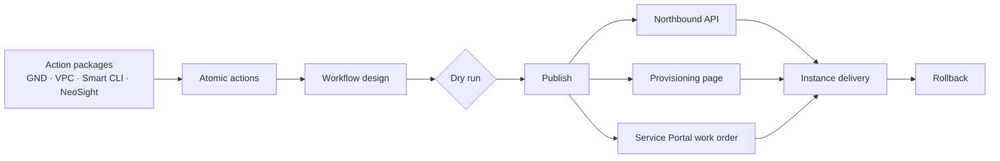
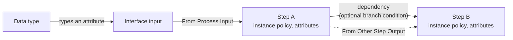
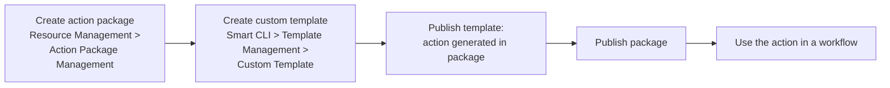

# Huawei iMaster NCE-Fabric Runbook (Digital Map)

Workflow orchestration in iMaster NCE-Fabric. It chains atomic actions into a workflow,
and publishing a workflow generates a northbound RESTful API that a work-order system can
call. It supports dry run, simulation and verification, progress queries, and rollback [1].

The MDC documentation files Runbook under Digital Map (Job View > iMaster NCE-Fabric MDC
Runbook) [2], and the fabric documentation under Reference > iMaster NCE-Fabric Runbook
[1]. Most facts here come from the fabric chapter. Digital Map itself is in
[digital-map.md](digital-map.md), and the solution the workflows provision is in
[cloudfabric.md](cloudfabric.md). See the [Huawei hub](huawei.md) for other product lines.

## Licensing

| Scope | License | Item | What it covers |
|---|---|---|---|
| Controller | Programmable Platform Package | Small 88037JQM, Medium 88037JQN, Large 88037JQP | Up to 20, 50, or 100 published runbook applications (templates) [1] |
| Controller (optional) | Intent Standard Package | 82801607 | Simulation and verification [1] |
| Device | Per Physical Modular Device Control-OPP Package | `NCE-Fabric-Mod-OPP-Pkg` | Delivering an instance to a modular device [3] |
| Device | Per Physical Fixed Device Control-OPP Package | `NCE-Fabric-Fxd-OPP-Pkg` | Delivering an instance to a fixed device [3] |

Without enough device licenses, delivery fails with a message that no license is
available. Check the items under System > License > License Information [3].

## Workflows

### Workflow components

A workflow is designed on a canvas (Runbook app, Runbook > Design State List > Design)
from these parts [1]:

| Component | Where | What it does |
|---|---|---|
| Data type | The design page's Data Types dialog > Create, or Resource Management for a public type | Groups attributes into a user-defined type. A private type belongs to one process or action package; a public type is copied into a process as a private type the first time it is referenced |
| Interface | The design page's **Interface Info** dialog, Input and Output areas | The input attributes become the request parameters of a workflow instance. An attribute's type is String, Integer, Boolean, Float, List, or a user-defined data type. A step can only use **From Process Input** for attributes defined here |
| Step | Dragged onto the canvas from the toolbox's Action or Process module | An atomic action, or a published workflow used as a sub-process. Steps are parallel until a dependency links them |
| Dependency | A solid line between two steps | The source step runs before the sink step, and rollback runs in reverse. Dependencies are inherited: if A depends on B and B on C, A depends on C |
| Branch condition | Hover over the arrow line between two steps and click the edit icon to open **Edit Branch Condition** | A condition on the dependency. Not allowed on lines from Start or to End |
| Instance policy | Each step | How many instances the step creates (see below) |
| Attribute value | Each step attribute | Where the attribute's value comes from (see below) |

Instance policies [1]:

| Policy | Creates |
|---|---|
| Default Policy | One instance |
| Quantity | A set number of instances |
| Condition Policy | One instance if the condition is true, none if it is false, 0, null, or an empty list or object |
| Cyclic Policy | One instance per element of a list; the instance ID comes from `iterator_index` or `iterator_value` |

Attribute value assignment modes [1]:

| Mode | Value comes from |
|---|---|
| Unassigned | Nothing (empty) |
| Constant Value | A value entered or selected |
| From Iteration Value | `iterator_index` or `iterator_value` of a Cyclic Policy |
| From Process Input | An interface input attribute, including nested ones such as `a.b.c` |
| From Process Template Parameter | A parameter of the process template |
| From This Step Input | Another input of the same step |
| From Other Step Input / From Other Step Output | An input or output of a step this one depends on, directly or indirectly |
| Simplified Mode | A whole list assigned to a list attribute |
| Advanced Mode | Blockly function blocks, for anything the other modes can't express |

### Blockly function blocks

Advanced Mode, branch conditions, and default values are built from Blockly function
blocks dragged together on a canvas [1]:

| Category | Blocks (examples) |
|---|---|
| Basic data | Number, string, null, true, false |
| Expression | not; and / or / equal; number comparison (`==`, `!=`, `<`, `<=`, `>`, `>=`); arithmetic; if-true-false; to Boolean, to string, to number; to JSON string, JSON to object; is null, is empty; encode, decode; timestamps; numeral-system conversion |
| Set | List operations (contains, value at index, count of value, index of value, first not none, unique, reverse, length); combine lists or maps; create a list or map; list filter (`==`, `!=`, `<`, `<=`, `>`, `>=`, contains, not contains, in, nin on each item or an item path); group by; lists to map; map to list; zip lists into objects |
| String | Replace, concatenate, find (returns a Boolean), split by a separator, substring, change case |
| Other | Generate UUID; run a Python script; JSON query (JSONPath on the data, with flag none, unique, or single); HTTP GET, POST, PUT, DELETE toward third-party systems |
| Loop | for over a list with a template; the loop variable's value |
| Model | Data from the process input, the process template, this step's input, another step's input or output, and the iteration index or value |

Rules that matter when combining them [1]:
- False, 0, null, `[]`, and `{}` count as false. An empty string counts as **true**.
- **is empty** returns true for null and for a string, list, or map of length 0.
- Blocks of different types can't be connected.
- **JSON query** with flag `single` returns the element itself when the result is a
  one-element list.

### Dry run and delivery

A dry run checks the syntax of the incremental configuration and shows a preview. It
doesn't check connectivity. It is supported only when every action in the workflow is
the same type and each action supports dry run itself, so a workflow that mixes Smart
CLI with GND or VPC actions skips it [1]. The preset border-leaf-to-PE workflows show
the rule. Each action there is GND, VPC, or Smart CLI, and only the workflow that mixes
types has no dry run [1]:

| Preset workflow | Actions | Dry run |
|---|---|---|
| `BL_SS_Outbound_Interface_Provision` | GND `gnd-interface-eth-trunk` (create, modify); Smart CLI `addTrunkPort` | No, "orchestrated using GND, VPC, and Smart CLI actions" |
| `BL_SS_Outbound_Route_BGP` | VPC `addBgpPeer` | Yes |
| `BL_SS_Outbound_Route_OSPF` | VPC `createOspfProcessPeer`, `queryOspfProcessList`, `createOSPFpeer` | Yes |
| `BL_CC_Outbound_Route_StaticRoute` | VPC `addroute` | Yes |
| `BL_ExtGateway_Provision` | VPC `createExtGateway` | Yes |

Delivery can use Auto Rollback, which rolls back every executed node if one fails. With
the dry run skipped, a workflow can also use breakpoint provisioning (pause at chosen
nodes) or scheduled provisioning [1].

### Rollback

A whole workflow can be rolled back whether delivery succeeded or failed. Device-based
rollback is Smart CLI only and works only after a delivery failure. A workflow that uses
the command configuration template can't be rolled back [1].

### Preset workflows

Built-in atomic workflows [1]:

| Area | Action types | Content |
|---|---|---|
| Firewall security policy (Palo Alto) | Smart CLI | Address and service sets, security zones, NAT rules, security policies |
| Border-leaf-to-PE interconnection | VPC, GND, Smart CLI | VPC `l2l3app-logic-routers` (`addBgpPeer`, `addroute`), `l2l3app-ospf` (`queryOspfProcessList`, `createOSPFpeer`, `createOspfProcessPeer`), `l2l3app-externalgateways` (`createExtGateway`); the Eth-Trunk workflow mixes GND and Smart CLI |
| MQC on CE switches | GND, Smart CLI | GND ACLs, traffic classifiers, behaviors, and policies; Smart CLI templates apply a traffic policy to an interface or globally |

A scenario-specific workflow generates and delivers security policy for Huawei USG,
Palo Alto, Cisco ASA and Firepower, Check Point, H3C, Hillstone, and Fortinet firewalls,
and for F5 load balancers [1].

Additional preset workflow packages are downloaded from the Huawei support site, each
with a `.p7s` signature file [1]:

| Use | Packages |
|---|---|
| IFIT | `…_Runbook_IFIT` |
| iNOF | `…_Runbook_nof` |
| FabricInsight (traffic mirroring, dialing tests, traffic analysis, syslog) | `…_Runbook_Erspan`, `…_Runbook_Gre`, `…_Runbook_Netstream`, `…_Runbook_SysLog` |
| Network migration | `…_Runbook_Cisco`, `…_Runbook_MLag` |
| ACI coexistence (MDC only) | `…_Runbook_APIC` [2] |

### Front ends

A custom provisioning page binds form fields (text box, drop-down, toggle) to a published
workflow's input parameters [1]. The Service Portal adds work orders with operator and
reviewer roles. It reviews both provisioning and rollback, and it can deliver at a set
time point or within a time window [1].

## Actions

### Action packages

Each package is a ZIP of TOSCA YAML files [1]:

| Type | Model | Used for |
|---|---|---|
| Open GND | YANG | Driving NEs, Day 0 work [1] |
| VPC | YAML | Day 1 VPC, route, and policy services [1] |
| Resources | | Underlay [1] |
| iMaster NeoSight | | Commands the unified NE model doesn't cover, imported separately [1] |
| Smart CLI | Velocity template | Generated from a custom template (see [Smart CLI](#smart-cli)) [1] |

The iMaster NeoSight action package (`iMasterNCE-Fabric_{version}_Runbook_package.zip`,
which the IFIT and FabricInsight workflows need) is downloaded from the Huawei support
site with a `.p7s` signature file [1]. An action package can also be generated from a
Swagger file [1].

### Action phases

An action has up to five phases: `beforeAction`, `do`, `retry`, `rollback`, and
`dryrun`. Each phase is a sequence of steps [1]:

| Step type | Does |
|---|---|
| `restful`, `restful_3rd`, `restful_3rd_driver_xxx` | REST request |
| `pythonapi` | Python script call |
| `throwexception` | Raises an error |

A step can be conditional, can poll, and can store response fields in variables for
later steps [1]. The Python script APIs are documented in the separate iMaster
NCE-Fabric API Development Guide [1][4].

### Prerequisites for the built-in VPC action packages

The built-in VPC actions need a certificate and an interconnection with a third-party
system before they can be used [1]:

1. Create a northbound user of type Third-party with the Northbound Interface Operator
   role (System app, Administrator > User Management).
2. Export the APIGWService identity certificate `server_chain.cer` (System Settings >
   Certificate Management), or export it from a browser at
   `https://<northbound floating IP>:18002`.
3. Import it as a PEM trust certificate into the mdcInterconnectionService service.
4. Under Network Planning and Construction > Interconnection > Third-Party System
   Management > Third-Party System, create a system of type DomainController. Its
   address is iMaster NCE-Fabric's own northbound floating IP, with northbound port 18002
   (fixed), UI port 31943 (default), and the user from step 1. Connectivity Detection
   must pass and Connection Status must show Online.

### Northbound APIs

Action packages use RESTful APIs, because Runbook orchestrates through them [3]. The
[prerequisites](#prerequisites-for-the-built-in-vpc-action-packages) register iMaster
NCE-Fabric as a DomainController system at its own northbound IP and port 18002, with a
Northbound Interface Operator user [1]. From this, the file infers that the built-in VPC
actions call the controller's own northbound VPC APIs. The action names and fields match
those APIs, for example the `queryLogicSwitch` action and Query a Logical Switch by ID,
so the API guide serves as the reference for each action's inputs and outputs. The APIs
are on port 18002 and need the northbound operator role [4]:

| API | Method and path | Notes |
|---|---|---|
| Query logical switches | `GET /controller/dc/v3/logicnetwork/switchs` | Filter by `logicSwitchName`, `tenantId`, `logicNetworkId`; returns `rtPrefix`, `importRouteTargets`, `exportRouteTargets` [4] |
| Query a logical switch by ID | `GET …/switchs/switch/{id}` | Same fields [4] |
| Logical switch device mapping | `GET /controller/dc/v3/logicnetwork/logictopo/switch-map` | Filter by `logicSwitchId`, `deviceIp`, `deviceId`; returns name, BD ID, VNI, RTs, and mapped devices with their route distinguishers [4] |
| Add static routes to a logical router | `POST /controller/dc/v3/logicnetwork/routers/router/{id}/route-sets` | `destination`, `nexthopIp`, `nexthopType`, `preference`, device group; matching GET, update, and delete calls exist [4] |

The Runbook section of the API guide serves the workflow level instead [4]:
- Python script management
- device-to-template matching (`POST /rest/controller/dc/v3/runbook/api/device-match`)
- an instance's incremental configuration for the `dryrun`, `do`, or `rollback` stage
  (`POST …/runbook/api/diff-config/instance/{instanceId}?stage=`)
- work-order synchronization, deployment scripts, and evaluation reports

It doesn't document the per-workflow APIs that publishing generates.

## Smart CLI

### Templates

Templates use Velocity syntax: `${var}`, `#set`, `#foreach` (nested up to three levels),
and `#if/#elseif/#else`. A template has up to 50 steps and 50 variables per step [1].
Each step is one of two kinds [1]:

| Step kind | Contains | Behavior |
|---|---|---|
| Delivery | Commands to deliver, each with an optional rollback command | Rollback commands map one-to-one to delivered commands; a command without one isn't removed on rollback |
| Detection item | One query command plus an output template | The output template extracts up to 10 variables and checks them against constraints; the step fails if the output doesn't match |

### Limits

iMaster NCE-Fabric doesn't reconcile or simulate configuration that Smart CLI delivers.
Smart CLI needs STelnet/SSH to the device. Huawei devices already have their SND
packages, and third-party devices need one developed. A GND action can't take parameters
that Smart CLI delivered as its input [1].

### Creating a Smart CLI action

The custom template names the vendor, the SND package, the action package, and the
action. Its steps go on the Distribute Configuration page [1].

The documentation's worked example, a `reload` action on a Cisco device, shows how the
generated action and its workflow step look [1]:
- **Generated action:** the `do` and `retry` phases post the template parameters
  (`${requestData.neParams}`) to `/rest/ipsmartcliservice/v1/action/deploy/reload`.
  The example edits them afterward to add an ExceptionIgnore condition, which treats the
  disconnection after a restart as normal.
- **Workflow step:** a cyclic instance policy over the input's device IDs runs the action
  once per device, with `neParams[0].neResId` taken from the iteration value.

### Preset templates and SND packages

The preset Smart CLI templates and SND packages are read-only. They are listed under
Smart CLI > Template Management > Default Template and Smart CLI > SmartCLI SND > Default
SmartCLI SND, and a preset template can be published as a custom one [1].

## References

[1] "Stellar AI Fabric Data Center Network Solution Product Documentation," Huawei,
V100R026C00, Library Version 01, 2026-09-30, HedEx library EDOC1100612448 (verify at
support.huawei.com HedEx, `docid=EDOC1100612448`). Verify in: Reference > iMaster NCE-Fabric
Runbook > Runbook Overview; Licensing Requirements for Runbook; Implementation > Runbook
Deliverable > Action Package; Implementation > Action Design > Action Design;
Implementation > Process Design > Dependencies, Instance Policy, and Attribute Value
Assignment; Smart CLI Configurations > Overview, and Overview of Smart CLI > Template
Specification Limitations and Usage Instructions, Template Functions > Delivering
Configurations and Configuring Rollback Commands, and Smart CLI Template Syntax; Smart CLI
Configurations > General Configurations > Using Runbook Workflows to Provision Template
Configurations > Provisioning a Runbook Instance; Workflow and Execution Record Management >
Operations After Dry Run > Viewing Incremental Configurations, and Runbook Workflow
Rollback; Preset Workflows > Preset Scenario-Specific Runbook Workflow Usage Guide > Atomic
Workflows > Built-in Atomic Workflow Lists > Interconnection Between Border Leaf Nodes and
PEs; Runbook GUI Design > Example for Configuring the Runbook Main Page > Creating a Custom
Process Provisioning Page; Service Portal > Overview, and Process and Status. For built-in
content: Preset Workflows > Preset Scenario-Specific Runbook Workflow Usage Guide > Atomic
Workflows > Built-in Atomic Workflow Lists (Security Policy Configuration on Firewalls,
Interconnection Between Border Leaf Nodes and PEs, MQC Configuration on Switches) and Atomic
Workflow Usage Guide > Checking Preset Workflows and Smart CLI Templates; … >
Scenario-Specific Workflows > Security Policy Configuration on Multiple Types of Firewalls >
Workflow Introduction; Preset Workflows > Preset Workflow Software Package Usage Guide >
Preset Workflows; Smart CLI Configurations > General Configurations > User Template > Preset
Templates and Preset SmartCLI SND Package; General Runbook Configurations > Action Package
Management > Creating an Action Package > Generating Action Packages. For downloaded packages
and the API guide: Preset Workflows > Preset Workflow Software Package Usage Guide and Preset
Network Migration Workflow Usage Guide > Importing a Network Migration Workflow; General
Runbook Configurations > Runbook Homepage Overview > General Runbook Settings. Confirmed Nov.
17, 2026. For the VPC action package prerequisites: General Runbook Configurations >
Importing Runbook Certificates > Obtaining and Importing a Built-in VPC Action Package
Certificate. For creating a Smart CLI action: Configuration Examples > Smart CLI Workflow
Cases > Creating an Action for Determining the Device Status After a Restart. For workflow
components: Implementation > Resource > Data Type; General Runbook Configurations > Runbook
Orchestration > Creating a Workflow Interface, (Optional) Creating Private Data Types for
Process Packages, and Orchestrating a Workflow; Implementation > Blockly Function Blocks.
Confirmed Nov. 18, 2026.

[2] "Stellar AI Fabric Data Center Network Solution Product Documentation (MDC Scenario),"
Huawei, V100R026C00, Library Version 01, 2026-09-30, HedEx library EDOC1100612446 (verify at
support.huawei.com HedEx, `docid=EDOC1100612446`). Verify in: Digital Map > Job View >
iMaster NCE-Fabric MDC Runbook, and its Preset Workflows > Preset ACI Coexistence Workflow Package
and Usage Guide > Importing a Preset APIC Workflow. Confirmed Nov. 17, 2026.

[3] "iMaster NCE-Fabric Product Documentation," Huawei, V100R026C00, Library Version 01,
2026-09-30, HedEx library EDOC1100609197 (verify at support.huawei.com HedEx,
`docid=EDOC1100609197`; the NCE-Fabric library, not the MDC one). Verify in: Maintenance
and Troubleshooting > Emergency Maintenance > Emergency Plan > Runbook > Common Exceptions
During Runbook Configuration Delivery > Lack of Runbook Licenses for Devices; and Restrictions
and Precautions > Runbook Constraints and Precautions. Confirmed Nov. 18, 2026.

[4] "iMaster NCE-Fabric API Development Guide," Huawei, V100R026C00, Library Version 01,
2026-09-30, HedEx library EDOC1100609192 (verify at support.huawei.com HedEx,
`docid=EDOC1100609192`). Verify in: RESTful API Development Guide > Interface Reference >
Runbook (Device Mapping Query Using Runbook, Runbook Incremental Configuration, Runbook
Python Script API, Runbook Work Order Northbound Interface); … > Interface Reference > VPC >
Logical Switch Management > Query Logical Switches and Query a Logical Switch by ID; … >
VPC > Logical Topology Management > Query the Device Mapping Information of All Logical
Switches; … > VPC > Logical Router Management > Add Static Route Information to a Logical
Router. Confirmed Nov. 17, 2026.
